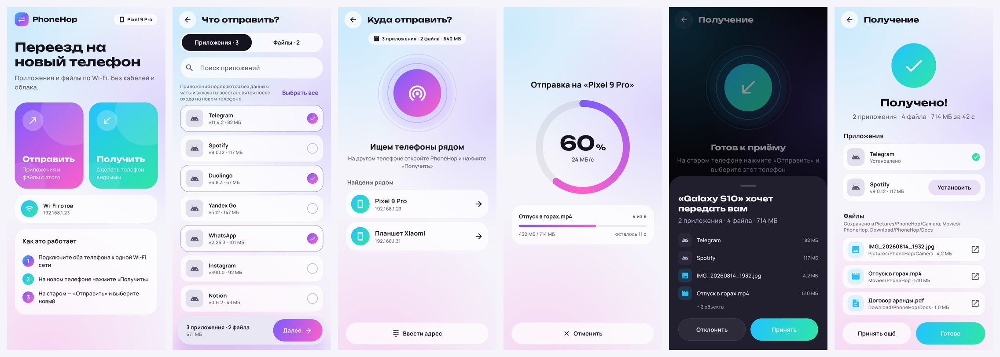
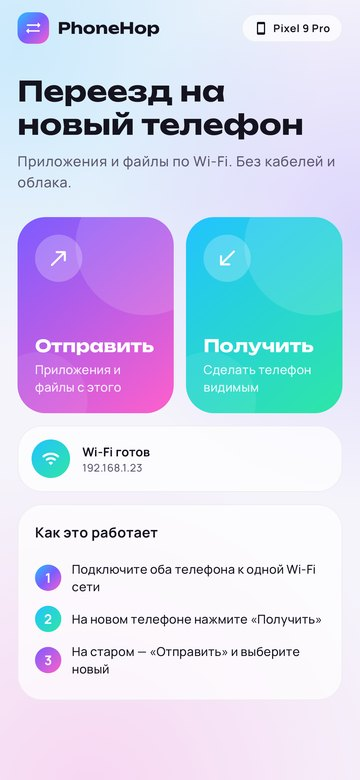
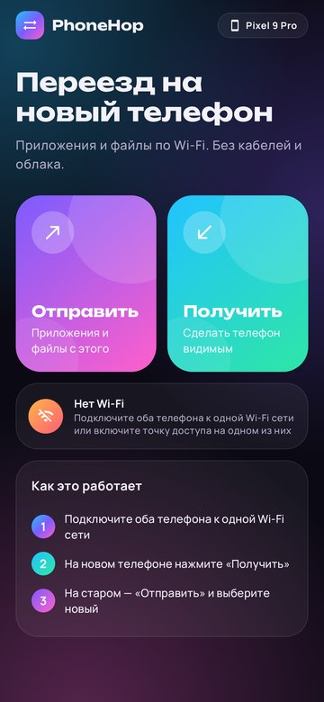

# PhoneHop — перенос приложений и файлов между телефонами по Wi‑Fi



PhoneHop переносит **установленные приложения** и **файлы** (фото, видео, документы, целые папки) с одного Android‑телефона на другой по локальной Wi‑Fi сети. Интернет и облако не нужны, кабели тоже.

## Скачать

**[dist/PhoneHop-1.0.0.apk](dist/PhoneHop-1.0.0.apk)** (1,7 МБ, Android 8.0 и новее)

SHA‑256: `e2ef8abe7b4dab60100cac5a28ce7f90e65c161dd335aafb7551369b25bc5e07`

Установите APK на **оба** телефона. При первой установке Android попросит разрешить установку из этого источника (браузера или файлового менеджера).

## Как пользоваться

1. Подключите оба телефона к одной Wi‑Fi сети. Если роутера нет, включите точку доступа на одном телефоне и подключите к ней второй.
2. На **новом** телефоне откройте PhoneHop и нажмите **«Получить»**.
3. На **старом** нажмите **«Отправить»**, отметьте приложения и файлы, нажмите **«Далее»** и выберите новый телефон в списке.
4. На новом телефоне нажмите **«Принять»**.
5. Когда передача закончится, нажмите **«Установить все»**, чтобы установить полученные приложения. Файлы сразу появляются в галерее и в «Загрузках».

Если телефон не находится автоматически (так бывает в гостевых и корпоративных сетях, где устройства изолированы друг от друга), нажмите **«Ввести адрес»** и введите IP, который показан на экране получателя.

## Возможности

- **Приложения**: передаются APK‑файлы, включая split‑APK (base + конфигурации) у приложений из Google Play. На новом телефоне они устанавливаются через системный установщик, по одному с подтверждением.
- **Файлы**: фото и видео через системный выбор медиа, любые документы, целые папки с подпапками. Полученное раскладывается по папкам `Pictures/PhoneHop`, `Movies/PhoneHop`, `Music/PhoneHop` и `Download/PhoneHop`.
- **Поиск телефонов**: автоматически через mDNS (DNS‑SD), есть ручной ввод адреса.
- **Надёжность**: у каждого файла проверяется контрольная сумма CRC32. Повреждённые и недокачанные файлы удаляются, уже полученное остаётся. Отмена с любой стороны сразу видна на другом телефоне.
- **Долгие передачи**: работают в фоне (foreground‑сервис с прогрессом в уведомлении), Wi‑Fi и процессор не засыпают при выключенном экране.
- **Интерфейс**: Jetpack Compose и Material 3, светлая и тёмная тема, русский и английский языки.

<p>
  
  
</p>

## Ограничения

- **Данные приложений не переносятся** (переписки, логины, настройки): без root Android не даёт их прочитать. После установки войдите в аккаунты заново или восстановите данные из резервной копии самого приложения.
- Split‑APK содержат части под процессор и экран исходного телефона. Если у телефонов разная архитектура (например, arm64 и 32‑битный arm), установка некоторых приложений не пройдёт, и PhoneHop покажет ошибку.
- Платные приложения и приложения с проверкой лицензии могут не запуститься после переноса.
- Данные идут по локальной сети без шифрования. Передавайте через свою домашнюю сеть или точку доступа телефона, а не через общественный Wi‑Fi. Принимать данные телефон начинает только на экране «Получить» и только после вашего «Принять».

## Как устроено

```
core/   чистый Kotlin/JVM: протокол передачи, сервер и клиент, защита путей, прогресс
app/    Android‑приложение: Compose UI, поиск устройств (NSD), сохранение (MediaStore),
        установка APK (PackageInstaller), foreground‑сервис
```

Протокол — простой TCP (порт 48484 или любой свободный):

1. Отправитель присылает манифест: список приложений и файлов с размерами и иконками.
2. Получатель отвечает «принять», «отклонить» или «занят».
3. Данные идут блоками (chunked), за каждым файлом следует CRC32. Любая сторона может прервать передачу и сообщить причину.

Получатель не доверяет данным из сети: пути вроде `../../` обезвреживаются, имена пакетов и APK проверяются, размеры и количество элементов ограничены.

## Тесты

Тесты запускаются на JVM, эмулятор не нужен:

| Набор | Что проверяет |
|---|---|
| `core` (24 теста) | передача через настоящие TCP‑сокеты: файлы и split‑APK байт в байт, файл 48 МБ, неизвестные размеры, отказ, «занят», отмена с обеих сторон, ошибка диска, порча данных (CRC), мусор в порт, несовместимая версия, защита путей |
| `PhoneToPhoneTest` | два «телефона» в одном процессе: настоящие `SendController` и `ReceiveController` передают приложение и файлы по TCP, проверяются отказ, отмена и недоступный получатель |
| `DataLayerTest`, `FileStoreTest` | список установленных приложений со split‑APK, чтение content://, раскладка файлов по папкам, имена без перезаписи |
| `ScreensTest`, `DialogsTest`, `MainActivitySmokeTest` | экраны Compose (Robolectric) и скриншоты, диалоги, настоящая `MainActivity` с переходами и режимом приёма |

```bash
./gradlew :core:test :app:testDebugUnitTest :app:lintDebug
```

Скриншоты экранов (папка `app/build/screenshots`):

```bash
./gradlew :app:recordRoborazziDebug
```

## Сборка

Нужны JDK 17+ и Android SDK (platform 37). Gradle скачается сам.

```bash
./gradlew :app:assembleRelease
```

APK появится в `app/build/outputs/apk/release/`. Сборка в GitHub Actions (`.github/workflows/android.yml`) прогоняет тесты и lint и выкладывает APK в артефакты.

### Подпись

`dist/PhoneHop-1.0.0.apk` подписан отладочным ключом. Чтобы обновлять приложение поверх уже установленного, все версии нужно подписывать одним и тем же ключом. Создайте свой ключ:

```bash
keytool -genkeypair -v -keystore phonehop-release.jks -alias phonehop -keyalg RSA -keysize 4096 -validity 10000
```

и положите рядом с проектом файл `keystore.properties` (в git он не попадает):

```properties
storeFile=phonehop-release.jks
storePassword=...
keyAlias=phonehop
keyPassword=...
```

Для GitHub Actions добавьте секреты `PHONEHOP_KEYSTORE_BASE64` (вывод `base64 -w0 phonehop-release.jks`), `PHONEHOP_STORE_PASSWORD`, `PHONEHOP_KEY_ALIAS` и `PHONEHOP_KEY_PASSWORD`.

## Лицензии

Шрифты Manrope и Unbounded распространяются по SIL Open Font License 1.1, см. [licenses/FONTS-OFL.txt](licenses/FONTS-OFL.txt).
