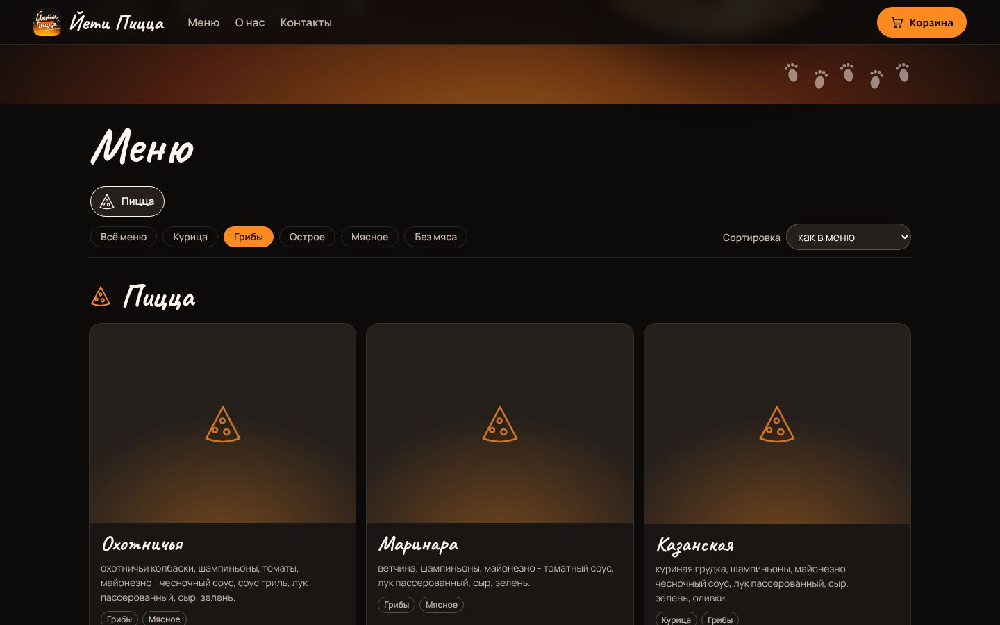
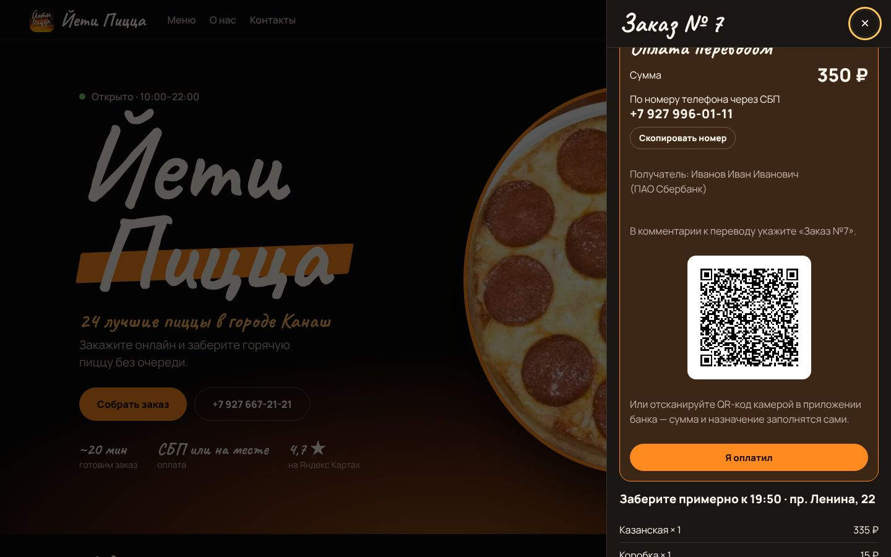
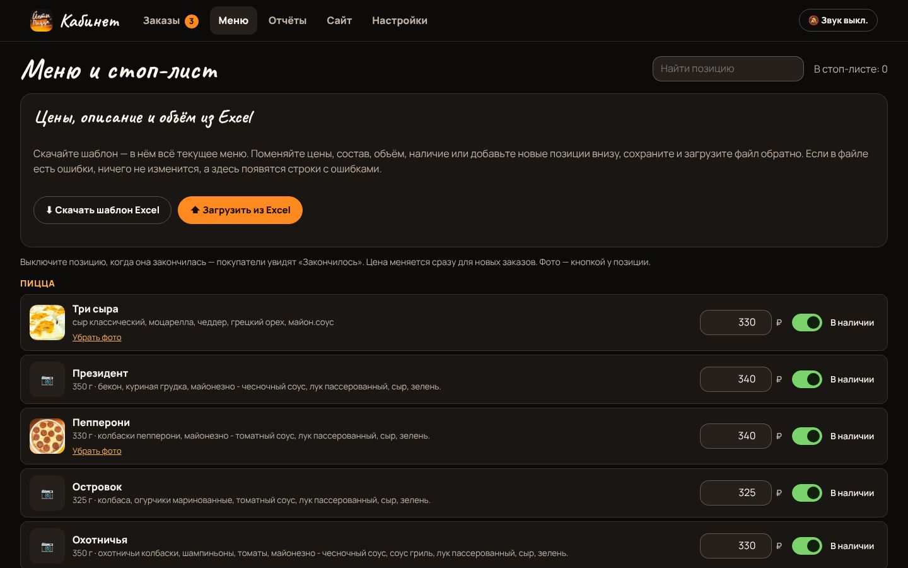
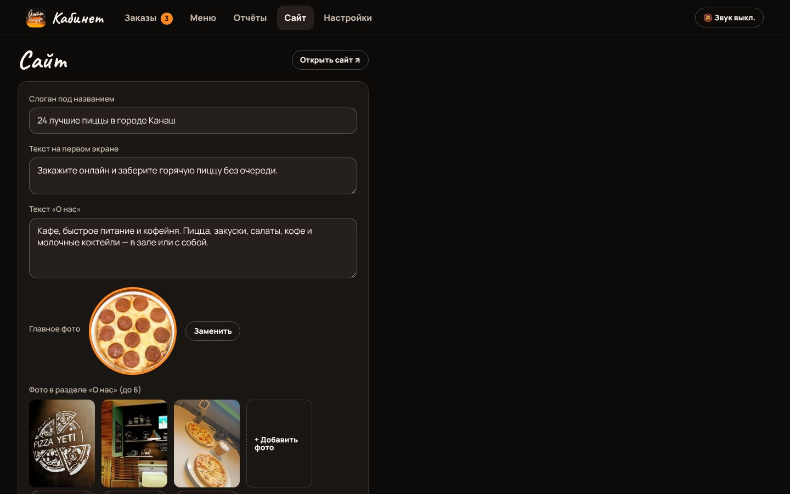

# Йети Пицца — сайт с самовывозом, приложение и кабинет пиццерии

Онлайн-заказ с самовывозом для «Йети Пиццы» (Канаш, проспект Ленина, 22): сайт и Android-приложение для покупателей, кабинет персонала на сайте и в том же приложении. Фирменный стиль взят с экранов меню в зале (макет в Canva): чёрный фон, оранжевое «пламя», рукописные названия, плашка логотипа и следы йети. Меню (81 позиция, цены) выгружено со [страницы пиццерии на Яндексе](https://jeti-pitstsa-prospekt-lenina.clients.site/), фото продуктов — из того же макета.


## Куда приходят заказы

```
 Сайт (покупатель) ─┐                         ┌─ Кабинет на сайте  /admin
                    ├─►  сервер + база SQLite ─┤
 Приложение ────────┘   (jeti-pizza/server)   └─ Кабинет в приложении + звонок о новом заказе
```

Все заказы, и с сайта, и из приложения, попадают на один сервер. Персонал видит их одинаково в кабинете на сайте и в приложении. Главное рабочее место — **планшет или телефон на кассе** с приложением: после входа в кабинет он каждые 15 секунд проверяет заказы и звонит уведомлением о каждом новом, даже с выключенным экраном. Кабинет на сайте подаёт звуковой сигнал, если включить «🔔 Звук» (браузер требует одного нажатия).

Путь заказа: **Новый → Готовится → Готов к выдаче → Выдан** (или «Отменён»). Покупатель видит этот статус на сайте и в приложении, и он меняется сразу, как только кухня нажала кнопку: экран заказа держит запрос к серверу, и сервер отвечает в момент смены статуса (или через 25 секунд без изменений, тогда экран спрашивает снова). Так же сразу видны «Я оплатил» у кухни и «Оплата получена» у покупателя.

## Как заказ связан с покупателем

Учётных записей у покупателей нет. Заказ привязан к **устройству**: после оформления сайт или приложение запоминает номер заказа и его секретный ключ (последние 5 заказов). По ним и открывается «Мой заказ». Адрес страницы заказа (`?order=…&t=…`) — это ссылка на него: её можно открыть на другом устройстве. Без ключа заказ не открыть, даже зная номер. Телефон и почта нужны кухне для связи и для охлаждения между заказами, но входом не служат: если очистить данные браузера или переустановить приложение, «Мой заказ» пропадёт, а сам заказ останется у кухни.

## Меню: фильтры, сортировка, упаковка



- **Разделы карточками:** нажали на карточку — открылся раздел, внизу кнопка «Дальше» к следующему. На карточке видно, сколько позиций раздела уже в корзине.
- **Фильтры по составу:** Курица, Грибы, Острое, Мясное, Без мяса. Метки ставятся сами по описанию (составу) позиции, поэтому меняются вместе с меню.
- **Сортировка по цене** внутри каждой категории: сначала дешевле или сначала дороже.
- **Упаковка добавляется сама.** На каждую пиццу, салат, фри, наггетсы, стрипсы и сырные палочки — коробка, на каждый кофе, чай, горячий шоколад и молочный коктейль — стакан (250 или 400 мл). В корзине это отдельные строки «добавлено автоматически». Сервер считает упаковку сам и игнорирует то, что прислал браузер. Если коробки закончились (стоп-лист), заказ всё равно оформляется. Бутылочные напитки (газировка, вода, сок, безалкогольное пиво) и соусы по умолчанию без стакана. Упаковку любой позиции можно поменять в Excel-шаблоне, в колонке «Упаковка».

## Оплата переводом по СБП



При оформлении покупатель выбирает «При получении» или «Переводом по СБП сейчас». Во втором случае после оформления он видит сумму, номер **+7 927 996-01-11** (кнопка «Скопировать»), получателя и банк, и просьбу указать в комментарии «Заказ №…». Перевести можно из приложения любого банка: Сбер, Т-Банк, ВТБ, Альфа и других. Затем покупатель нажимает **«Я оплатил»**, а в кабинете у заказа появляется «Перевод: покупатель оплатил — проверьте банк». Когда деньги пришли, сотрудник нажимает **«Оплата пришла»**, и покупатель видит «Оплата получена ✓».

**QR-код.** Если в кабинете (Настройки → Оплата переводом) заполнить реквизиты счёта — получатель, банк, расчётный счёт, БИК, корр. счёт, — на сайте с компьютера появится платёжный QR-код по ГОСТ Р 56042. Его сканируют камерой в приложении банка, и сумма с номером заказа подставляются сами. По одному номеру телефона QR-код сделать нельзя: такого стандарта для переводов частному лицу нет. На телефоне QR не показывается, потому что телефон не может отсканировать собственный экран.

**SberPay и оплата картой на сайте** требуют договора эквайринга с банком или платёжным сервисом (например, ЮKassa подключает SberPay, СБП и карты сразу). Деньги при этом поступают на расчётный счёт, а не на номер телефона, и сервис сам пробивает чек. Когда будет договор, понадобятся `shopId` и секретный ключ, и это подключается отдельно.

> ⚠️ Приём оплаты за еду переводами на личный номер банк может посчитать предпринимательской деятельностью и ограничить карту (115-ФЗ). Кроме того, по закону о кассах (54-ФЗ) на каждую оплату нужен чек. Для постоянной работы лучше подключить эквайринг или СБП-QR для бизнеса в своём банке.

## Охлаждение между заказами

С одного **телефона** или одной **почты** нельзя оформить новый заказ раньше, чем через N минут после предыдущего (по умолчанию 15). Проверка выполняется на сервере, поэтому её не обойти ни с сайта, ни из приложения. Покупатель видит таймер обратного отсчёта. Отменённые заказы не учитываются. Время меняется в кабинете → «Настройки», 0 — без ограничения. Номера приводятся к одному виду (`8 927…`, `+7 927…` и `927…` — один номер), почта — к нижнему регистру.

## Кабинет персонала


| Раздел | Что там |
|---|---|
| **Заказы** | Доска из трёх колонок: Новые, Готовятся, Готовы к выдаче. В карточке номер, к какому времени забрать, имя, телефон (нажать — позвонить), состав с упаковкой, комментарий, способ оплаты и её состояние, сумма, кнопка следующего шага и отмена с подтверждением. «Оплата пришла» отмечает перевод. «История» — все заказы за выбранный день. |
| **Меню** | Разделы слева, позиции выбранного раздела справа компактной таблицей, плюс «Все позиции» и «Стоп-лист». Цена и наличие меняются прямо в строке. Фото позиции: нажмите на квадрат слева от названия. Кнопки **«Скачать шаблон Excel»** и **«Загрузить из Excel»** (см. ниже). |
| **Отчёты** | По позициям за сегодня, вчера, 7 или 30 дней или любой период: штуки, выручка, доля, итог, число заказов, средний чек, отменено. Сортировка по выручке или по штукам, выгрузка в CSV. |
| **Сайт** | Слоган, текст первого экрана и «О нас», главное фото, до 6 фото в разделе «О нас». Сохранили — сайт обновился, приложение показывает новый слоган. |
| **Настройки** | Пауза онлайн-заказов, время охлаждения, оплата переводом (номер, получатель, банк, реквизиты для QR), смена пароля, выход. |

### Цены, описание и объём из Excel



1. **«Скачать шаблон Excel»** — файл `.xlsx` со всем текущим меню. Колонки: ID, Раздел, Название, Описание (состав), Объём, Цена ₽, В наличии (да/нет), Упаковка.
2. Меняйте цены, состав, объём, наличие и упаковку. Новая позиция — строка внизу с пустым ID и с разделом. Колонку ID не трогайте.
3. **«Загрузить из Excel»**. Кабинет покажет, что изменится: у каких позиций и что именно (цена «было → станет», описание, объём…), и какие позиции добавятся. Сохраняется всё разом только после «Сохранить». Если в файле ошибка (нет такого раздела, цена не числом, название встречается в меню несколько раз), **ничего не меняется**, и кабинет показывает номера строк с ошибками.

Подходят `.xlsx` и `.csv` (в том числе CSV из русского Excel: точка с запятой, Windows-1251). Подойдёт и свой прайс: столбцы находятся по заголовкам («Позиция»/«Название», «Цена», «Объём», «Описание»…), а позиции без ID — по названию, если оно в меню одно (иначе по названию и объёму).

### Фото и тексты сайта



Фото уменьшаются прямо в браузере перед загрузкой: снимок с телефона на 5–10 МБ превращается примерно в 200 КБ, а данные о месте съёмки удаляются. Сервер принимает только JPG, PNG и WebP и проверяет первые байты файла. Загруженные фото лежат рядом с базой (`data/uploads`), поэтому попадают в ту же резервную копию.

## Android-приложение


Одно приложение для покупателей и персонала: разделы меню карточками, фото, фильтры по составу и сортировка по цене, круглая кнопка корзины, корзина с автоматической упаковкой, выбор времени самовывоза и оплаты, статус заказа с инструкцией для перевода и кнопкой «Я оплатил», звонок в пиццерию. Кнопки входа для персонала покупатели не видят: кабинет открывается **долгим нажатием на надпись «Йети Пицца»** на главном экране (на сайте — по адресу `/admin`). В кабинете приложения: заказы (с отметкой «Оплата пришла»), стоп-лист, отчёты и настройки. Импорт из Excel и редактирование сайта — в кабинете на сайте, с компьютера удобнее. На планшете доска заказов показывает три колонки:


## Правила заказа

- Онлайн-заказы принимаются с 10:00 до 21:30 (время Москвы), вне этого времени оформить заказ нельзя, и сайт с приложением говорят об этом. Готовим около 20 минут, время самовывоза берётся с шагом 15 минут, последнее — 21:45. Часы задаются в `server/menu.json`: `open`, `lastOrder` и `close` (до него идут слоты самовывоза).
- С одного подключения (IP-адреса) не больше 30 заказов за 10 минут, чтобы скрипт не завалил кухню шуточными заказами. Порог щедрый, потому что абоненты одного мобильного оператора бывают за одним адресом. Меняется переменной `ORDERS_PER_IP`, 0 — без ограничения.
- Цены, упаковка и сумма считаются на сервере. Цена из запроса покупателя не используется.
- Алкогольное пиво не продаётся онлайн: дистанционная продажа алкоголя в РФ запрещена. Безалкогольный «Бад» в меню остался.
- Часы работы, адрес, телефон и время приготовления задаются в `server/menu.json`. Меню из этого файла попадает в базу только при первом запуске. Дальше меню ведётся в кабинете и через Excel, а новые позиции из файла добавляются при перезапуске.

## Попробовать на своём компьютере и телефоне

1. Установите Node.js (версия LTS) с [nodejs.org](https://nodejs.org).
2. Скачайте проект: на GitHub выберите ветку и нажмите **Code → Download ZIP**, затем распакуйте архив.
3. Запустите сервер.
   - **Windows:** дважды щёлкните `jeti-pizza/server/start-windows.bat` и придумайте пароль для кабинета. Если Windows спросит про доступ Node.js к сети, разрешите доступ для частных сетей, иначе телефон не достучится до сервера.
   - **macOS и Linux:** в терминале выполните `cd jeti-pizza/server && ADMIN_PASSWORD=ваш-пароль npm start`.
4. На компьютере откройте http://localhost:8080 (сайт) и http://localhost:8080/admin (кабинет, логин `admin`).
5. Установите на телефон [`dist/YetiPizza-test-1.2.0.apk`](../dist/YetiPizza-test-1.2.0.apk). Телефон должен быть в той же Wi-Fi сети, что и компьютер. Откройте приложение, введите адрес, который сервер напечатал в строке «С телефона в той же Wi-Fi сети» (например `192.168.1.5:8080`), и нажмите **«Подключиться»**.

Тестовый APK работает по обычному http и умеет спрашивать адрес сервера. Сборка для настоящего сервера с https (см. ниже) такого поля не показывает. Кнопка «Скопировать номер» на сайте по обычному http показывает номер вместо копирования: браузеры дают доступ к буферу обмена только по https.

## Размещение в интернете

Подойдёт любой VPS с Docker и домен, направленный на этот сервер. HTTPS-сертификат Caddy получит и будет продлевать сам.

```bash
cd jeti-pizza/server
cp .env.example .env    # впишите DOMAIN и ADMIN_PASSWORD
docker compose up -d --build
```

База данных и загруженные фото лежат в томе `pizza-data`, сохраняйте его копию. Пароль, сменённый в кабинете, переживает перезапуски. Чтобы сбросить забытый пароль, впишите новый `ADMIN_PASSWORD` в `.env` и перезапустите сервер.

## Сборка приложения

Приложение собирается вместе с остальным проектом (модуль `:pizza`). Адрес сервера задаётся при сборке:

```bash
./gradlew :pizza:assembleRelease -PpizzaServerUrl=https://ваш-домен
```

APK будет в `jeti-pizza/android/build/outputs/apk/release/`. На GitHub Actions APK собирается сам (артефакт `YetiPizza-apk`), адрес берётся из переменной репозитория `PIZZA_SERVER_URL` (Settings → Secrets and variables → Actions → Variables). Без адреса приложение обращается к `http://10.0.2.2:8080`, то есть к серверу на компьютере из эмулятора Android. Релизная сборка подписана отладочным ключом: для публикации в магазине нужен свой ключ.

## Тесты

- `jeti-pizza/server/test` — охлаждение, часы приёма заказов и время самовывоза, стоп-лист, отчёт, вход и пароль; упаковка; метки состава; оплата переводом и QR; импорт меню (шаблон туда и обратно, предпросмотр, файл как от Excel, CSV в Windows-1251, поиск по названию, отказ всего файла при ошибке); проверка фото и текстов сайта. Отдельно — живой сервер: мгновенная смена статуса у покупателя, отказ запросам не в JSON (защита от подделки запроса с чужого сайта), файлы вне `public/` не отдаются, лимит заказов с одного адреса, импорт только для персонала, загрузка только настоящих фото.
- `jeti-pizza/android/src/test` — сетевой клиент и полный прогон против живого сервера (в CI автоматически, локально — при заданных `PIZZA_SERVER_URL` и `PIZZA_ADMIN_PASSWORD`). Проверка QR-кодов сервера независимым декодером ZXing. Отрисовка экранов со скриншотами: `./gradlew :pizza:testDebugUnitTest -Proborazzi.test.record=true`.

## Чего нет

- Онлайн-оплаты картой и SberPay: нужен договор эквайринга (см. выше). Переводы по СБП подтверждаются вручную.
- Письма и SMS покупателю не отправляются: номер и статус заказа покупатель видит на экране, ссылка на заказ — адрес страницы.
- Звонок о новых заказах в приложении работает через опрос сервера раз в 15 секунд, а не через push (для push нужен проект Firebase).
- Ограничение только по телефону и почте. Защиты от заказов с разных выдуманных номеров с одного устройства нет.
- Персонажи со слайдов (йети из «Смолфута», Салли из «Корпорации монстров») на сайт не перенесены: это чужие защищённые персонажи. Фото продуктов взяты из макета пиццерии в Canva и со страницы на Яндекс Картах. Если в макете использовались стоковые фото, проверьте, что лицензия позволяет размещать их на сайте.
