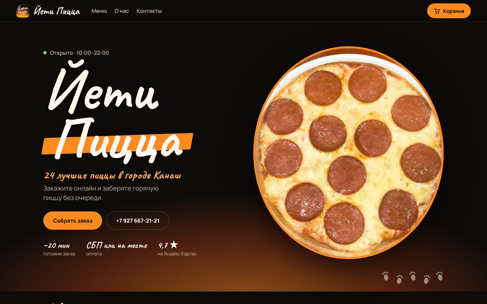
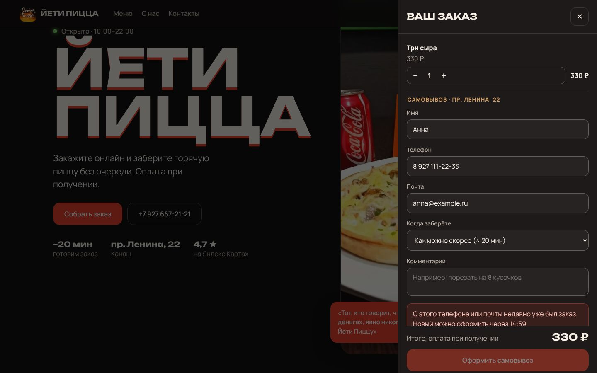
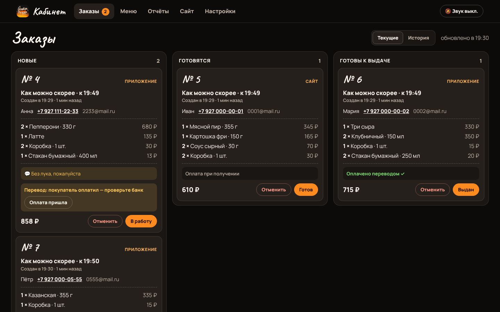
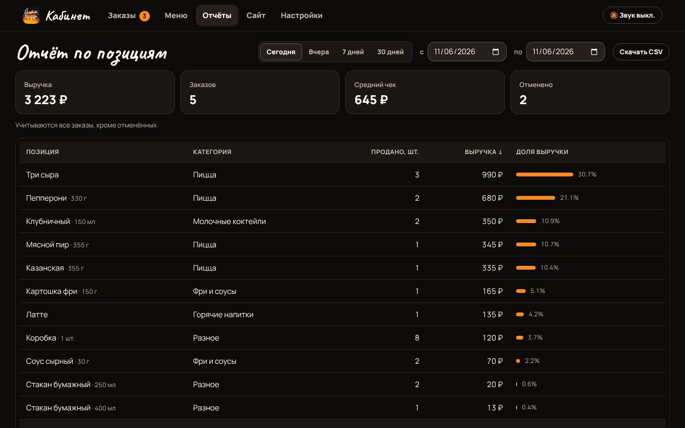
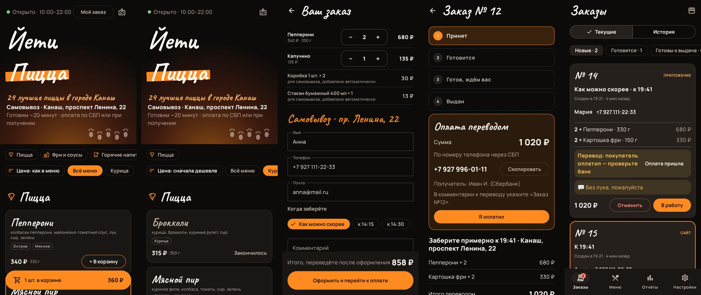
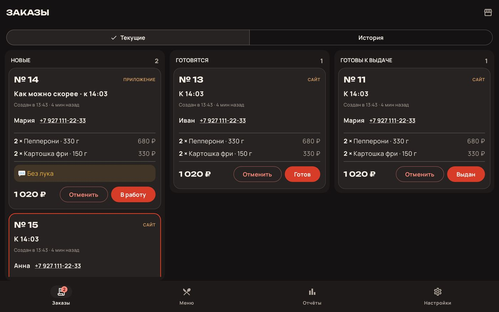

# Йети Пицца — сайт с самовывозом, приложение и кабинет пиццерии

Онлайн-заказ с самовывозом для «Йети Пиццы» (Канаш, проспект Ленина, 22): сайт и Android-приложение для покупателей, кабинет персонала на сайте и в том же приложении. Стиль взят из самой пиццерии: тёмные «меловые» стены, красная вывеска, дерево и зелёная подсветка зала. Меню (81 позиция, цены) выгружено с [страницы пиццерии на Яндексе](https://jeti-pitstsa-prospekt-lenina.clients.site/).



## Куда приходят заказы

```
 Сайт (покупатель) ─┐                         ┌─ Кабинет на сайте  /admin
                    ├─►  сервер + база SQLite ─┤
 Приложение ────────┘   (jeti-pizza/server)   └─ Кабинет в приложении + звонок о новом заказе
```

Все заказы, и с сайта, и из приложения, попадают на один сервер. Персонал видит их одинаково в кабинете на сайте и в приложении. Главное рабочее место — **планшет или телефон на кассе** с приложением: после входа в кабинет он каждые 15 секунд проверяет заказы и звонит уведомлением о каждом новом, даже с выключенным экраном. Кабинет на сайте подаёт звуковой сигнал, если включить «🔔 Звук» (браузер требует одного нажатия).

Путь заказа: **Новый → Готовится → Готов к выдаче → Выдан** (или «Отменён»). Покупатель видит этот статус на сайте и в приложении, и он меняется сразу, как только кухня нажала кнопку: экран заказа держит запрос к серверу, и сервер отвечает в момент смены статуса (или через 25 секунд без изменений, тогда экран спрашивает снова).

## Как заказ связан с покупателем

Учётных записей у покупателей нет. Заказ привязан к **устройству**: после оформления сайт или приложение запоминает номер заказа и его секретный ключ (последние 5 заказов). По ним и открывается «Мой заказ». Адрес страницы заказа (`?order=…&t=…`) — это ссылка на него: её можно открыть на другом устройстве. Без ключа заказ не открыть, даже зная номер. Телефон и почта нужны кухне для связи и для охлаждения между заказами, но входом не служат: если очистить данные браузера или переустановить приложение, «Мой заказ» пропадёт, а сам заказ останется у кухни.

## Охлаждение между заказами

С одного **телефона** или одной **почты** нельзя оформить новый заказ раньше, чем через N минут после предыдущего (по умолчанию 15). Проверка выполняется на сервере, поэтому её не обойти ни с сайта, ни из приложения. Покупатель видит таймер обратного отсчёта, когда снова можно заказать. Отменённые заказы не учитываются: если кухня отменила заказ, покупатель может сразу оформить новый. Время меняется в кабинете → «Настройки», 0 — без ограничения. Номера приводятся к одному виду (`8 927…`, `+7 927…` и `927…` — один номер), почта — к нижнему регистру.



## Кабинет персонала



| Раздел | Что там |
|---|---|
| **Заказы** | Доска из трёх колонок: Новые, Готовятся, Готовы к выдаче. В карточке номер, к какому времени забрать, имя, телефон (нажать — позвонить), состав, комментарий, сумма, кнопка следующего шага и отмена с подтверждением. Новые заказы подсвечены, просроченное время выдачи — красным. «История» — все заказы за выбранный день, статус можно поменять задним числом. |
| **Меню** | Разделы слева, позиции выбранного раздела справа компактной таблицей, плюс «Все позиции» и «Стоп-лист». Стоп-лист: выключите позицию, и покупатели увидят «Закончилось». Цену можно поменять прямо в строке. **Цены из Excel:** «Скачать прайс (Excel)» даёт файл со столбцами Код, Раздел, Позиция, Объём, Цена; исправьте цены и нажмите «Загрузить цены из Excel». Кабинет покажет, что изменится (было → станет), и какие строки пропущены, и только после «Применить» сохранит всё разом. Подходят .xlsx и .csv; позиции находятся по коду, а без кода — по названию. Новые заказы идут по новой цене, старые сохраняют свою. |
| **Отчёты** | По позициям за сегодня, вчера, 7 или 30 дней или любой период: сколько продано штук, выручка и доля в выручке, итог, число заказов, средний чек, отменено. Сортировка по выручке или по штукам, выгрузка в CSV (открывается в Excel). Отменённые заказы в продажи не входят. |
| **Настройки** | Пауза онлайн-заказов (если кухня перегружена), время охлаждения, звонок о заказах на этом устройстве (в приложении), смена пароля, выход. |



## Android-приложение



Одно приложение для покупателей и персонала: разделы меню карточками (нажали — открылся раздел), круглая кнопка корзины, выбор времени самовывоза («как можно скорее» или к определённому времени), статус заказа и звонок в пиццерию. Кнопки входа для персонала покупатели не видят: кабинет открывается **долгим нажатием на надпись «Йети Пицца»** на главном экране. На сайте кабинет тоже не показан, он открывается по адресу `/admin`. На планшете доска заказов показывает три колонки, как на сайте:



## Правила заказа

- Онлайн-заказы принимаются с 10:00 до 21:30 (время Москвы), вне этого времени оформить заказ нельзя, и сайт с приложением говорят об этом. Готовим около 20 минут, время самовывоза берётся с шагом 15 минут, последнее — 21:45. Часы задаются в `server/menu.json`: `open`, `lastOrder` и `close` (до него идут слоты самовывоза).
- С одного подключения (IP-адреса) не больше 30 заказов за 10 минут, чтобы скрипт не завалил кухню шуточными заказами. Порог щедрый, потому что абоненты одного мобильного оператора бывают за одним адресом. Меняется переменной `ORDERS_PER_IP`, 0 — без ограничения.
- Цены и сумма считаются на сервере. Цена из запроса покупателя не используется.
- Оплата при получении. Онлайн-оплаты нет.
- Алкогольное пиво не продаётся онлайн: дистанционная продажа алкоголя в РФ запрещена. Безалкогольный «Бад» в меню остался.
- Часы работы, адрес, телефон и время приготовления задаются в `server/menu.json`. Там же меню: новые позиции добавятся при перезапуске, а цены и стоп-лист из кабинета сохраняются.

## Запуск на компьютере

Нужен Node.js 22.13 или новее, других зависимостей нет.

```bash
cd jeti-pizza/server
ADMIN_PASSWORD=придумайте-пароль npm start
```

Сайт откроется на http://localhost:8080, кабинет — на http://localhost:8080/admin (логин `admin`). Если не задать `ADMIN_PASSWORD`, сервер придумает пароль при первом запуске и напишет его в консоль. Тесты: `npm test`.

## Попробовать на своём компьютере и телефоне

1. Установите Node.js (версия LTS) с [nodejs.org](https://nodejs.org).
2. Скачайте проект: на GitHub выберите ветку и нажмите **Code → Download ZIP**, затем распакуйте архив.
3. Запустите сервер.
   - **Windows:** дважды щёлкните `jeti-pizza/server/start-windows.bat` и придумайте пароль для кабинета. Если Windows спросит про доступ Node.js к сети, разрешите доступ для частных сетей, иначе телефон не достучится до сервера.
   - **macOS и Linux:** в терминале выполните `cd jeti-pizza/server && ADMIN_PASSWORD=ваш-пароль npm start`.
4. На компьютере откройте http://localhost:8080 (сайт) и http://localhost:8080/admin (кабинет, логин `admin`).
5. Установите на телефон [`dist/YetiPizza-test-1.0.0.apk`](../dist/YetiPizza-test-1.0.0.apk). Телефон должен быть в той же Wi-Fi сети, что и компьютер. Откройте приложение, введите адрес, который сервер напечатал в строке «С телефона в той же Wi-Fi сети» (например `192.168.1.5:8080`), и нажмите **«Подключиться»**.

Тестовый APK работает по обычному http и умеет спрашивать адрес сервера. Сборка для настоящего сервера с https (см. ниже) такого поля не показывает.

## Размещение в интернете

Подойдёт любой VPS с Docker и домен, направленный на этот сервер. HTTPS-сертификат Caddy получит и будет продлевать сам.

```bash
cd jeti-pizza/server
cp .env.example .env    # впишите DOMAIN и ADMIN_PASSWORD
docker compose up -d --build
```

База данных лежит в томе `pizza-data`, сохраняйте её копию. Пароль, сменённый в кабинете, переживает перезапуски. Чтобы сбросить забытый пароль, впишите новый `ADMIN_PASSWORD` в `.env` и перезапустите сервер.

## Сборка приложения

Приложение собирается вместе с остальным проектом (модуль `:pizza`). Адрес сервера задаётся при сборке:

```bash
./gradlew :pizza:assembleRelease -PpizzaServerUrl=https://ваш-домен
```

APK будет в `jeti-pizza/android/build/outputs/apk/release/`. На GitHub Actions APK собирается сам (артефакт `YetiPizza-apk`), адрес берётся из переменной репозитория `PIZZA_SERVER_URL` (Settings → Secrets and variables → Actions → Variables). Без адреса приложение обращается к `http://10.0.2.2:8080`, то есть к серверу на компьютере из эмулятора Android. Релизная сборка подписана отладочным ключом: для публикации в магазине нужен свой ключ.

## Тесты

- `jeti-pizza/server/test` — охлаждение по телефону и почте, часы приёма заказов и время самовывоза, стоп-лист, отчёт по позициям, вход, сессии и смена пароля, импорт цен из Excel и CSV. Отдельно — живой сервер: мгновенная смена статуса у покупателя, отказ запросам не в JSON (защита от подделки запроса с чужого сайта), файлы вне `public/` не отдаются, лимит заказов с одного адреса.
- `jeti-pizza/android/src/test` — сетевой клиент: ошибки, охлаждение, PATCH. Полный прогон против живого сервера: заказ → охлаждение → вход персонала → отмена → цена → отчёт → выход. В CI он запускается автоматически, локально — при заданных `PIZZA_SERVER_URL` и `PIZZA_ADMIN_PASSWORD`. Ещё там отрисовка всех экранов со скриншотами: `./gradlew :pizza:testDebugUnitTest -Proborazzi.test.record=true`.

## Чего нет

- Письма и SMS покупателю не отправляются: почта нужна для охлаждения и связи. Номер и статус заказа покупатель видит на экране, ссылка на заказ — адрес страницы.
- Звонок о новых заказах в приложении работает через опрос сервера раз в 15 секунд, а не через push (для push нужен проект Firebase).
- Ограничение только по телефону и почте. Защиты от заказов с разных выдуманных номеров с одного устройства нет.
- Фото на сайте взяты со страницы пиццерии на Яндекс Картах. Перед публикацией убедитесь, что владелец не против.
